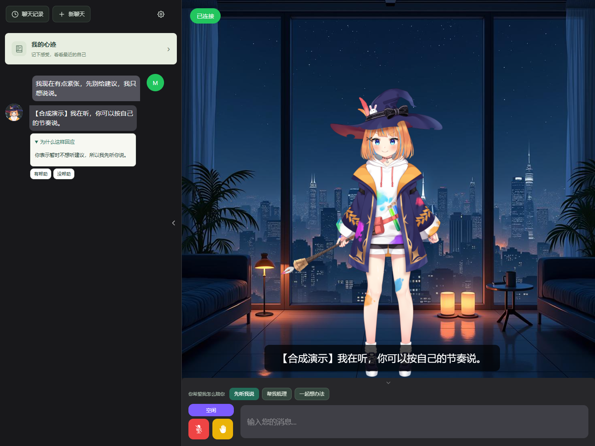
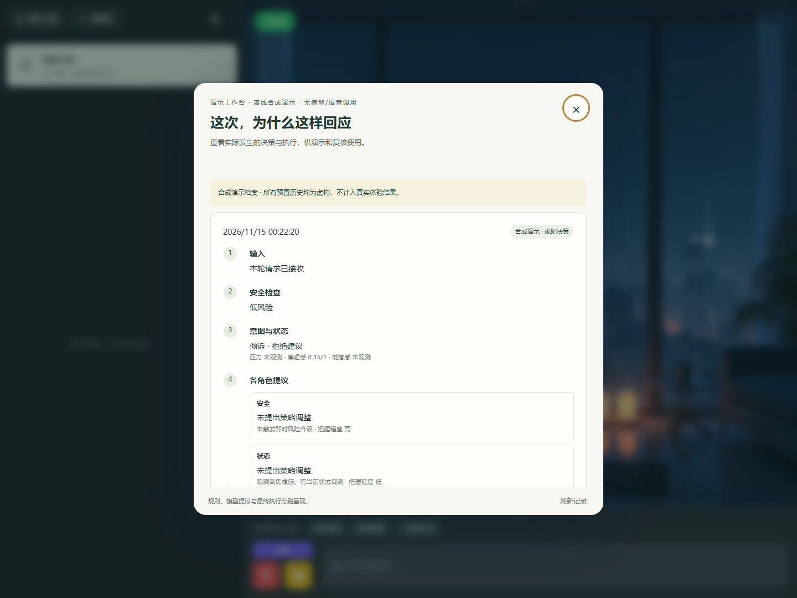
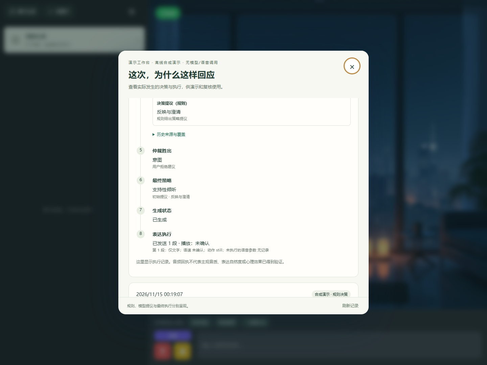
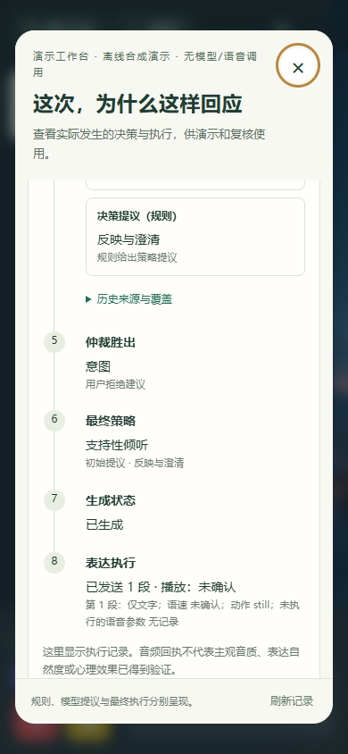

# 多角色仲裁与回复解释

2026-11-15。任务三提交 `d85af59` 已推送至远端 main。任务四在现有本机协调器中记录安全、状态、意图、反馈、历史、决策提议六类角色的建议与依据，前端显示仲裁时间线及逐条回复的折叠解释。

## 记录与界面

`AgentProposal` 仅接受角色、策略、受限证据码与可选把握程度。每轮同时保存 `winner_role`，状态快照中的未观测维度为 null。原文和自由文本推理不进入这些字段。规则决策、独立决策模型和模型失败后的规则回退分别标明来源。字段中的把握程度用于提议依据的可解释性，尚未做统计校准。

协调器原有 if/elif 顺序沿用，安全、结束、反馈、拒绝建议、倾诉、主动求助、梳理及协议边界分支按既有优先级执行。历史提议复用规则决策的历史可参考条件。危机或固定边界回复走生成前安全门，仅记录执行过的安全提议。输出改写、阻断或本地协议重定向发生时，将最终胜出角色更新为安全。

用户在 AI 回复下展开“为什么这样回应”，可查看由胜出角色和原因码映射的一句解释。技术回放展示输入、安全检查、意图与状态、各角色提议、仲裁胜出、最终策略、生成状态、表达与播放回执。历史记录缺少新字段时显示未记录。用户纠正历史后，旧历史解释显示快照失效。

历史实验的审计器会恢复记录中的决策来源再重放。旧记录缺少 proposals、winner_role 时兼容读取，新记录中已保存的提议和胜出字段仍逐项核对。

## 验证

| 验证 | 实际结果 |
|---|---|
| 后端 unittest discover | 206 项通过 |
| Ruff check | All checks passed |
| Ruff format --check | 52 files already formatted |
| 前端 node --test tests/*.test.cjs | 19 项通过 |
| npm run build:web | 生产构建成功，保留 Vite 的大包提示 |
| 390 × 844 浏览器布局 | documentWidth 与 viewport 均为 390，无横向溢出 |

新增后端测试覆盖全部协调分支的 winner_role、状态与历史规则提议、独立模型来源、危机绕过、生成中途安全调整、原文隔离及旧审计兼容。新增前端测试覆盖解释与 turn_id 对应、默认折叠、最终安全调整、历史失效、旧消息缺字段，以及零分和未观测维度的显示。

额外执行 typecheck:web 时，当前版本与任务三提交的独立基线快照均报告 585 项 TypeScript 错误，错误行列表逐条一致，主要分布在 WebSDK 及既有未使用导入。浏览器页面重载时还观察到 Live2D release/getArray 初始化异常，稍后头像正常显示。以上事项仍需后续处理。

## 界面证据

截图通过现有 `scripts/companion_demo.py` 运行真实产品 API、WebSocket 和协调器生成，使用新的独立合成档案。对话为固定示例文字，未调用模型或语音服务。示例表达暂时拒绝建议，历史和规则决策提议先澄清，最终意图角色胜出并采用支持性倾听。播放状态按实际文字发送显示未确认。









可在仓库根目录执行以下命令，以新的合成档案复核。首次创建目录时省略 --resume，后续重开该档案添加 --resume。

```powershell
.\.venv\Scripts\python.exe scripts/companion_demo.py --output private/demos/task4-20261115 --serve --port 12404 --resume
```

打开 `http://127.0.0.1:12404/`，在合成档案内完成界面体验选择，输入示例消息后展开解释。打开 `http://127.0.0.1:12404/?view=demo` 查看回放，向下滚动可查看胜出角色和播放状态。
